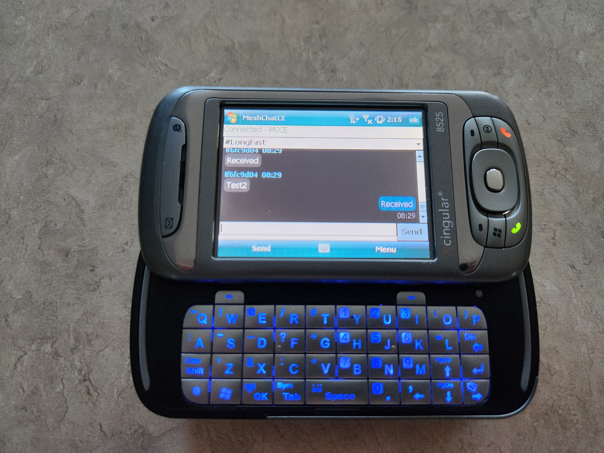
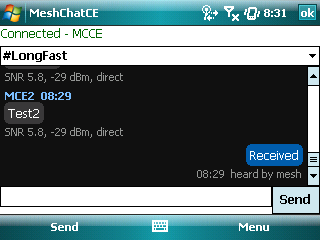
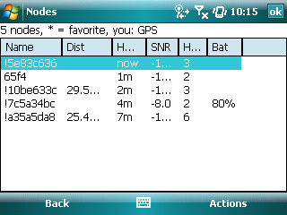
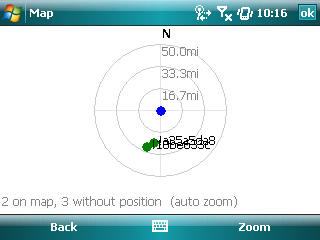

# MeshChatCE

**A native Windows Mobile client for Meshtastic.**
Turn an old Windows Mobile phone into an off-grid mesh messenger — with a real
keyboard, chat bubbles, a radar map, GPS and more. No cell service, no internet.



> MeshChatCE is an independent hobby project and is not affiliated with or
> endorsed by the Meshtastic project. "Meshtastic" is a trademark of its
> respective owners.

---

## How it works

```
 [ Windows Mobile phone ]  --Wi-Fi-->  [ hotspot ]  <--Wi-Fi--  [ Meshtastic node ]  ~~LoRa~~>  the mesh
   MeshChatCE                          (ESP8266 or any router)    (e.g. Heltec V3)
```

The phone talks to a Meshtastic node over Wi-Fi using Meshtastic's network
API (TCP port 4403). The node does the radio work; the phone is the screen
and keyboard. If there's no router around, a tiny ESP8266 board acts as a
pocket hotspot ([sketch included](hotspot/MeshHotspot/MeshHotspot.ino)).

## Features

- **Chat** on every channel your node has, plus **direct messages**
- **Texting-style bubbles** (or a compact classic list), with a "▼ New message" bar
- **Delivery status**: sending → heard by mesh / delivered / failed (with plain-English reasons)
- **Nodes list**: last heard, signal (SNR), hops, battery, distance — tap a heading to sort
- **Favorites**, **traceroute**, **search** across the whole message history
- **Bluetooth GPS** support: shares your position, distance and direction to nodes
- **Radar map** — works with no internet: you in the middle, nodes around you
- **Range log** to CSV for mapping coverage
- **Mesh stats**, **quick replies**, sound + vibration, background pop-up and blinking LED
- **Screenshots** from the phone (Tools → Screenshot)
- **Rename your node**, and **Send my info / Swap info** to fix encryption-key errors
- Text size, Tahoma/Courier fonts, **Light / Dark / Night (red)** themes
- Settings screen, keep-awake option, starts at boot and waits for Wi-Fi

| Chat | Nodes | Map |
|---|---|---|
|  |  |  |

## Requirements

**Phone**
- Windows Mobile 5, 6, 6.1 or 6.5 (touchscreen "Professional/Classic") with Wi-Fi
- .NET Compact Framework 3.5, installed to **main memory**
  (`NETCFv35.wm.armv4i.cab`, from Microsoft's `NetCFSetupv35.msi`)

**Radio**
- A Meshtastic node with Wi-Fi (ESP32 boards such as the Heltec V3),
  on the same network as the phone

**Optional**
- An ESP8266 board (e.g. Wemos D1 Mini) as a pocket hotspot
- A Bluetooth NMEA GPS (tested with a GlobalSat BT-359)

### Tested on
- AT&T 8525 / HTC TyTN (Hermes), Windows Mobile 6, with a Heltec V3

### Should work on (reports welcome!)
HTC TyTN II / Tilt, Touch Diamond / Pro / Pro2, HD2; HP iPAQ hx4700 / 21x;
Dell Axim X51(v); Palm Treo 800w / Pro; Samsung i760; Sony Ericsson Xperia X1;
rugged handhelds like the Symbol/Zebra MC55/MC65/MC75. Pocket PC 2003 devices
with Wi-Fi may work too. Please open an issue with your results.

## Quick start

1. **Download** `MeshChatCE.exe` from the [Releases](../../releases) page.
2. **Set up the network and node** — see [docs/SETUP.md](docs/SETUP.md).
3. **Install .NET CF 3.5** on the phone (to main memory).
4. **Copy `MeshChatCE.exe`** to the phone (e.g. the SD card) and tap it.
5. If your node isn't at `192.168.4.250`, change it in **Menu → Options → Settings**.

Want it to start with the phone? Put a shortcut to `MeshChatCE.exe` in
`\Windows\StartUp`. It waits for Wi-Fi before connecting.

## Building from source

No Visual Studio needed — just Windows, .NET Framework 3.5 and the free
.NET Compact Framework 3.5 redistributable. See [docs/BUILDING.md](docs/BUILDING.md).

## Pocket kit

Heltec V3 + ESP8266 + one LiPo + one switch in a small box. See
[docs/POCKET_KIT.md](docs/POCKET_KIT.md).


## Files on the phone

| File | What it holds |
|---|---|
| `MeshChatCE.ini` | connection, GPS, units, alerts, quick replies |
| `meshchat_settings.txt` | text size, theme, font, sound, favorites |
| `meshchat_history.txt` | your message history |
| `meshchat_range.csv` | range log (when used) |

These stay on your phone — they're personal and are excluded from the repo.

## Tips

- The node serves **one app at a time** over Wi-Fi. Close the phone app or
  web client if MeshChatCE says it "keeps getting cut off".
- On some phones, Bluetooth searching disturbs Wi-Fi. The GPS is only used
  when you switch it on, and MeshChatCE stops looking after 3 failed tries.
- Shared positions are visible to everyone on your channel. Turn sharing off
  in Settings, or lower the channel's position precision, if you prefer.
- DM fails with a key error? **Nodes → Actions → Swap info**, then retry.

## Legacy version

[`legacy/pythonce`](legacy/pythonce) has the earlier PythonCE + Pocket IE
version (no install of .NET needed, but slower).

## License

See [LICENSE](LICENSE).

## Thanks

To the Meshtastic project and community, the XDA-Developers and HPC:Factor
communities for keeping these old devices alive, and OpenStreetMap contributors.
