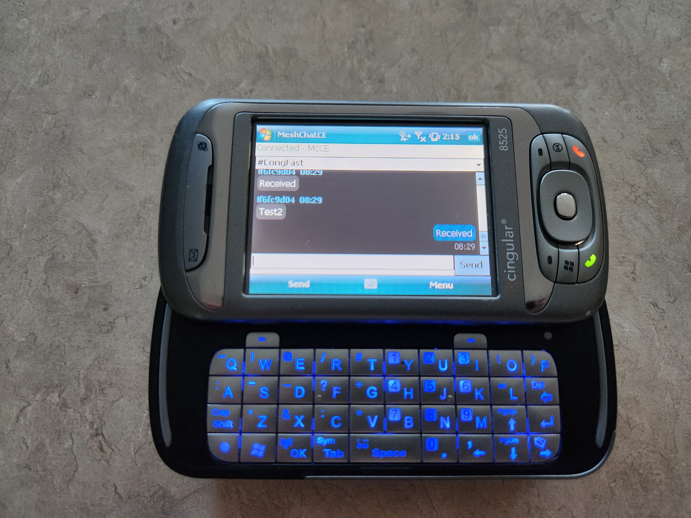

# Pocket kit: Heltec V3 + ESP8266 hotspot on one battery

One LiPo, one switch, one USB-C port for charging. The phone is the only other
thing you carry.



## Parts

| Part | Notes |
|---|---|
| Heltec WiFi LoRa 32 **V3** + LoRa antenna | runs Meshtastic, charges the battery |
| ESP8266 board, e.g. **Wemos D1 Mini** | runs the hotspot sketch |
| **1S LiPo**, 2000–3000 mAh, with protection circuit | |
| 2-pin **JST 1.25 mm** plug for the Heltec battery port | **check polarity** |
| **5 V boost converter** (fixed 5 V, ≥ 500 mA) | feeds the D1 Mini's 5V pin |
| 100–470 µF capacitor | across the booster output |
| Slide switch | in the battery + line |
| Small project box (~100 × 60 × 30 mm) | |

## Wiring

```
 LiPo (+) --[SWITCH]--+------------> Heltec battery plug (+)
                      |
                      +--> Booster IN+      Booster OUT+ (5 V) --> D1 Mini 5V
 LiPo (-) ------------+--> Booster IN-      Booster OUT-       --> D1 Mini GND
                      +------------> Heltec battery plug (-)

 Capacitor across Booster OUT+ / OUT-  (mind its polarity)
```

## Using it

| Switch | USB-C in the Heltec | Result |
|---|---|---|
| On | no | normal use on battery |
| On | yes | **charging** (and running) |
| Off | yes | Heltec runs from USB, battery **not** charging |
| Off | no | everything off |

- The Heltec's orange LED is **steady while charging**, off when full.
- Charging while running is slower — charge overnight.
- Battery % is estimated from voltage and moves slowly while charging.
- Rough runtime: ~10 hours on 2500 mAh with everything on. Lowering the
  hotspot's `TX_POWER_DBM` to 10 stretches it.

## Cautions

- **Check battery polarity** before plugging into the Heltec.
- **Always attach the LoRa antenna** before powering on.
- **Switch off before plugging USB into the D1 Mini** to reprogram it.
- If you use an adjustable booster (e.g. MT3608), **set it to 5.0 V with a
  multimeter before** connecting the D1 Mini.
- Some Heltec V3 boards won't take power from USB-C-to-C chargers — use a
  USB-A to USB-C cable.
- LiPo safety: protected cell, no crushing or puncturing, pad it in the case.
